# 英格客户云员工端使用手册（含管理员附录）

> 文档版本：1.2
>
> 适用版本：英格客户云 2026.08.18.1
> 适用对象：组织管理员、团队主管、普通成员、只读人员  
> 内网入口：<http://10.3.10.195:8080/>  
> 公网入口：<http://101.43.22.42:38080/>

本手册以普通员工 `MEMBER` 的日常操作为主线，覆盖英格客户云当前全部业务页面、主要操作、角色权限和数据安全规则；团队主管及组织管理员专属功能集中在对应章节和管理员附录中。带有员工角色标识的截图均来自正式站员工端，管理员截图不会作为员工操作入口说明。截图中的业务数据仅用于说明界面位置；实际可见内容由当前账号的组织、团队、角色、客户负责人和授权范围共同决定。

## 目录

1. [系统概览](#1-系统概览)
2. [账号、登录与注册](#2-账号登录与注册)
3. [界面导航与角色权限](#3-界面导航与角色权限)
4. [工作台](#4-工作台)
5. [客户档案全流程](#5-客户档案全流程)
6. [跟进提醒](#6-跟进提醒)
7. [任务中心](#7-任务中心)
8. [自媒体内容任务](#8-自媒体内容任务)
9. [内容圈子](#9-内容圈子)
10. [公告中心](#10-公告中心)
11. [团队数据与线索审核](#11-团队数据与线索审核)
12. [每日汇报](#12-每日汇报)
13. [批量导入](#13-批量导入)
14. [数据导出](#14-数据导出)
15. [智能助手](#15-智能助手)
16. [组织管理](#16-组织管理)
17. [智能助手管理员配置](#17-智能助手管理员配置)
18. [账户设置与退出](#18-账户设置与退出)
19. [推荐业务流程](#19-推荐业务流程)
20. [安全、审计与接口说明](#20-安全审计与接口说明)
21. [常见问题](#21-常见问题)

---

## 1. 系统概览

英格客户云用于统一管理营销团队的客户线索、沟通记录、跟进安排、团队任务、自媒体内容、日报、公告和智能助手。系统的核心原则是：

- 每位客户只有一份持续更新的业务档案。
- 每次有效沟通均进入时间线，并可同步更新客户状态、标签和下次跟进。
- 负责人、录入人、团队范围和组织范围由服务端权限控制。
- 团队任务覆盖发布、领取、执行、提交、退回、验收和关闭全过程。
- 客户线索、日报和内容任务使用统一统计口径，避免重复手工填报。
- 导入、导出、管理员修改、AI 调用等关键动作进入审计日志。

### 1.1 支持的浏览器

推荐使用最新版 Chrome、Edge 或 Safari。桌面端建议宽度不低于 1024 像素；系统也支持手机和窄屏浏览，导航会自动收缩到页面顶部。

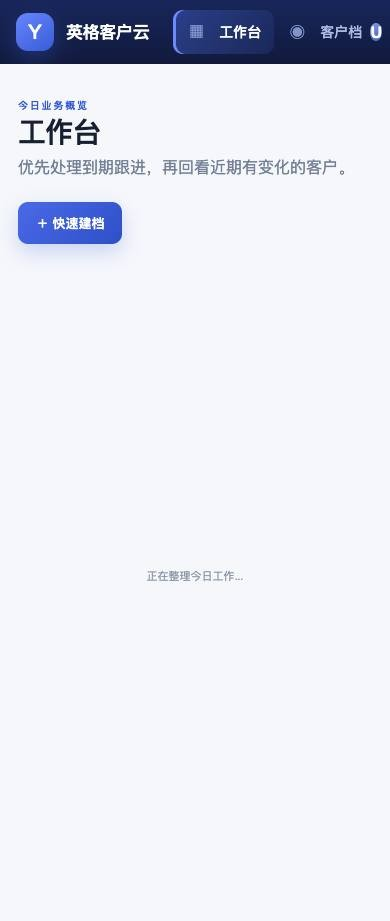

### 1.2 页面与功能总览

| 功能区域 | 主要用途 | 常用角色 |
| --- | --- | --- |
| 工作台 | 今日待办、逾期、高意向和近期更新概览 | 全部登录用户 |
| 客户档案 | 建档、查重、画像、沟通、归档、时间线导出 | 管理员、主管、成员；只读人员仅查看 |
| 跟进提醒 | 查看待处理、已完成、已取消提醒 | 全部登录用户 |
| 任务中心 | 分发、领取、提交、验收、关闭和删除任务 | 管理员、主管、成员 |
| 每日汇报 | 提交每日问题、计划和深度沟通数据 | 管理员、主管、成员 |
| 内容任务 | 发布内容、更新指标、审核内容和统计进度 | 管理员、主管、成员 |
| 内容圈子 | 按分区、平台、发布人和指标浏览内容 | 全部登录用户 |
| 公告中心 | 查看、发布、编辑、置顶和归档公告 | 全部可查看；管理员和主管可发布 |
| 更新日志 | 查看云端版本的新功能、改进、修复与安全说明 | 全部登录用户 |
| 团队数据 | 团队筛选、成员筛选、线索审核、日报与内容进度 | 管理员、主管 |
| 批量导入/导出 | 批量迁入或导出当前权限范围内的客户 | 管理员、主管 |
| 智能助手 | 结构化草稿和每日智能简报 | 管理员、主管、成员 |
| 组织管理 | 成员、团队、字典、标签、审计和 AI 配置 | 组织管理员 |

---

## 2. 账号、登录与注册

### 2.1 登录

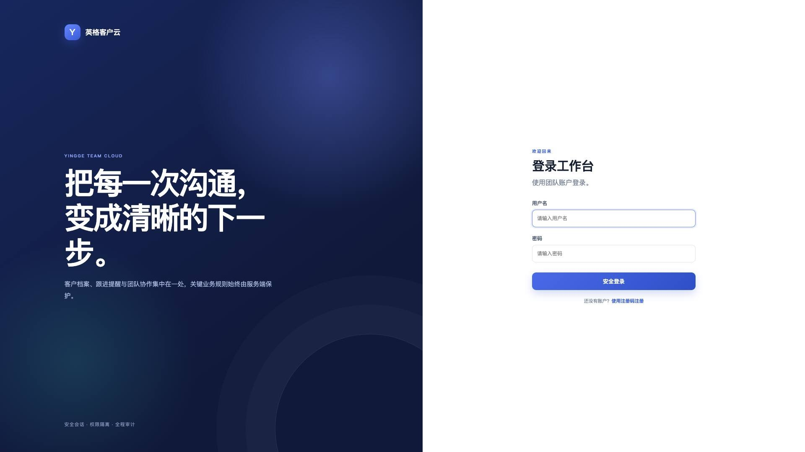

1. 打开系统地址。
2. 输入管理员分配的用户名和密码。
3. 点击“安全登录”。
4. 登录成功后进入工作台；若登录前访问了某个受保护页面，系统会返回原目标页面。

登录失败时，页面会显示服务端返回的原因。请先检查用户名、密码和账号状态；连续失败不要反复尝试，应联系组织管理员确认账号是否已停用。

系统会话默认保持 30 天，同一账号最多保留 5 个并发会话。修改密码、账号停用或会话过期后，应重新登录。

### 2.2 使用注册码注册

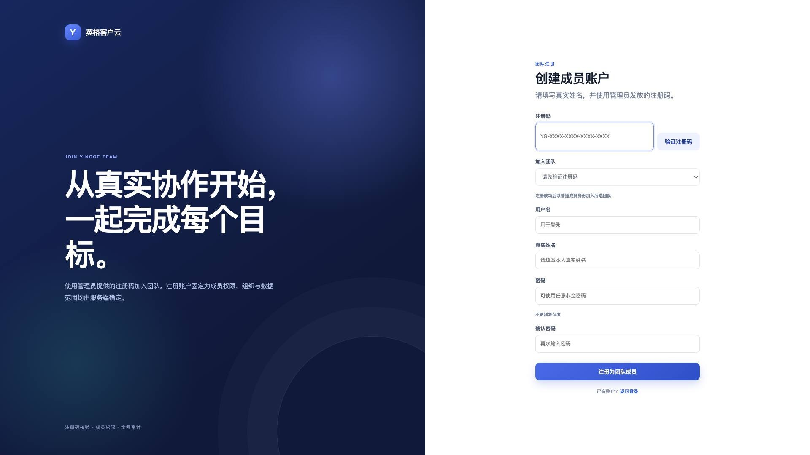

1. 在登录页点击“使用注册码注册”。
2. 输入管理员发放的注册码，点击“验证注册码”。
3. 在返回的团队列表中选择要加入的团队。
4. 填写用于登录的用户名、本人真实姓名、密码和确认密码。
5. 点击“注册为团队成员”。
6. 注册完成后返回登录页。

注意事项：

- 注册码有使用次数、有效期和启停状态限制。
- 注册成功后的角色固定为 `MEMBER`，不能通过注册页面选择管理员权限。
- 必须填写真实姓名；真实姓名用于客户负责人、日报、内容发布人和审计记录展示。
- 系统当前只要求密码非空，但仍建议使用不少于 12 位、包含数字与字母的独立密码。
- 注册码仅应提供给本组织人员，不要转发到公开群或外部平台。

---

## 3. 界面导航与角色权限

登录后，桌面端左侧导航分为“主要业务”“每日执行”“效率工具”和“组织管理”。页面左下角显示当前真实姓名和角色，点击该区域进入账户设置。

普通员工通常只看到工作台、客户档案、跟进提醒、任务中心、内容圈子、公告中心、每日汇报、内容任务和智能助手。“团队数据”“批量导入/导出”和“组织管理”不会出现在 `MEMBER` 导航中。

### 3.1 角色说明

| 权限能力 | ORG_ADMIN | TEAM_MANAGER | MEMBER | VIEWER |
| --- | :---: | :---: | :---: | :---: |
| 查看授权范围内客户 | ✓ | ✓ | ✓ | ✓ |
| 新建、编辑客户 | ✓ | ✓ | ✓ | — |
| 记录沟通、处理提醒 | ✓ | ✓ | ✓ | — |
| 查看团队数据 | 全组织 | 所负责团队 | — | — |
| 审核有效线索 | ✓ | 所负责团队 | — | — |
| 创建、关闭、删除工作任务 | ✓ | — | — | — |
| 验收任务 | ✓ | 所负责团队 | — | — |
| 提交内容与日报 | ✓ | ✓ | ✓ | — |
| 审核自媒体内容 | ✓ | 所负责团队 | — | — |
| 发布公告 | ✓ | ✓ | — | — |
| 批量导入、导出 | ✓ | ✓ | — | — |
| 使用智能助手 | ✓ | ✓ | ✓ | — |
| 管理成员、团队、字典、审计、AI 配置 | ✓ | — | — | — |

### 3.2 数据可见范围

- `ORG_ADMIN` 可查看本组织全部数据，但不能跨组织访问。
- `TEAM_MANAGER` 可查看自己负责团队的成员、客户、沟通、日报、任务提交和内容进度。
- `MEMBER` 主要查看自己负责、自己录入、被授权或所属团队允许查看的客户。
- `VIEWER` 只能查看明确归属自己或明确授权给自己的客户，不具备客户写入权限。
- 页面隐藏不代表唯一安全措施；所有权限还会在服务端再次校验。

---

## 4. 工作台

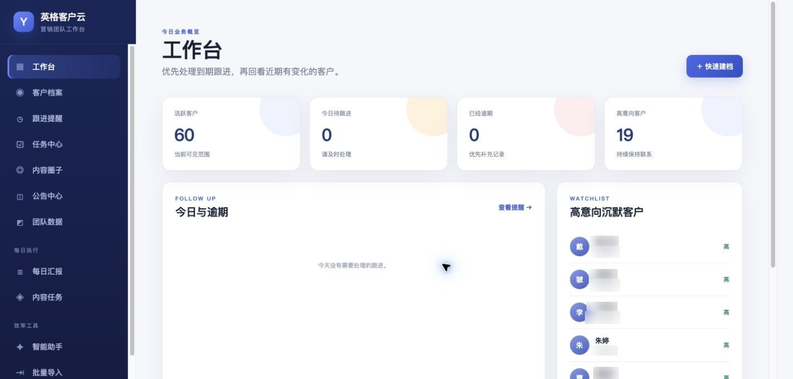

工作台用于安排当天优先级，包含以下信息：

- **活跃客户**：当前账号可见且未归档的客户数量。
- **今日待跟进**：下次跟进时间在今天的客户。
- **已经逾期**：跟进时间早于当前时间且仍未处理的客户。
- **高意向客户**：当前可见范围内的高意向客户。
- **今日与逾期**：集中展示必须优先处理的客户。
- **高意向沉默客户**：意向较高但近期缺少有效沟通的客户。
- **近期更新**：最近发生画像或沟通变化的客户。

推荐每日操作顺序：

1. 先处理“已经逾期”。
2. 再处理“今日待跟进”。
3. 检查“高意向沉默客户”。
4. 最后浏览“近期更新”，确认团队协作结果。

点击右上角“快速建档”可直接进入新建客户页面。

---

## 5. 客户档案全流程

### 5.1 客户列表、搜索与筛选

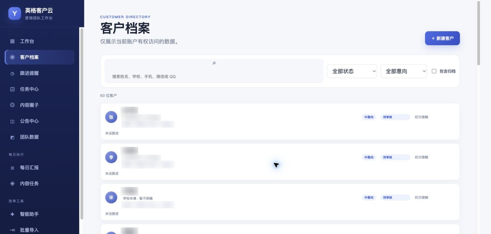

客户列表支持：

- 按姓名、学校、手机号、微信号或 QQ 号搜索。
- 按当前状态筛选：新客户、跟进中、已转化、暂缓等。
- 按报名意向筛选：高、中、低、未知。
- 勾选“包含归档”查看已归档客户。
- 使用“上一页”“下一页”浏览分页结果。

搜索框输入后会自动刷新，不需要按回车。列表只返回当前账号有权查看的客户；即使知道其他客户的 UUID，也不能绕过服务端权限。

### 5.2 新建客户

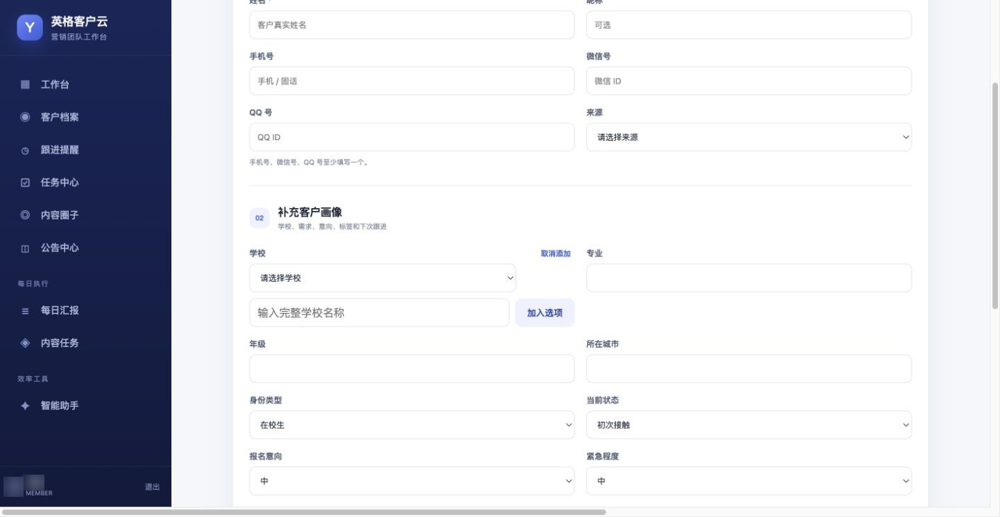

最低必填信息为：

- 客户真实姓名。
- 手机号、微信号、QQ 号至少填写一个。

可选画像包括昵称、来源、学校、专业、年级、城市、身份类型、当前状态、报名意向、紧急程度、核实状态、关注方向、客户标签、需求摘要、内部备注和下次跟进时间。

建档步骤：

1. 点击“客户档案”右上角“新建客户”，或在工作台点击“快速建档”。
2. 输入姓名和至少一种联系方式。
3. 离开姓名、专业或联系方式输入框时，系统自动执行查重。
4. 如无冲突，按需展开“补充客户画像”。
5. 点击“创建客户”。

学校填写规则：

1. 展开“补充客户画像”，在“学校”下拉框中选择学校。
2. 系统默认提供“示例大学”和“示例科技大学”。
3. 如果列表中没有目标学校，点击“＋ 添加学校”。
4. 输入学校的完整正式名称，点击“加入选项”。
5. 新增成功后系统自动选中该学校；该组织其他成员之后也可以直接选择。

添加学校会写入本组织的学校字典并记录审计。请不要使用简称、学院名称或带年级的文本代替学校全称；若系统提示“该学校已在选项中”，取消添加并在下拉框中选择现有项目。只读角色不能添加学校。

查重规则：

- 手机号、微信号或 QQ 号精确相同时会阻止重复建档。
- 姓名与专业同时一致时，即使联系方式完全不同，也会提示“姓名与专业一致的客户冲突”；确认是不同客户后，必须填写“继续创建原因”才能建档。
- 仅姓名相似时，系统会显示候选档案；确认是同名不同人后，同样必须填写“继续创建原因”。
- 如果重复档案存在但当前账号无权查看，系统只提示隐藏命中数量，不泄露对方组织或私有客户详情。

### 5.3 客户画像与沟通时间线

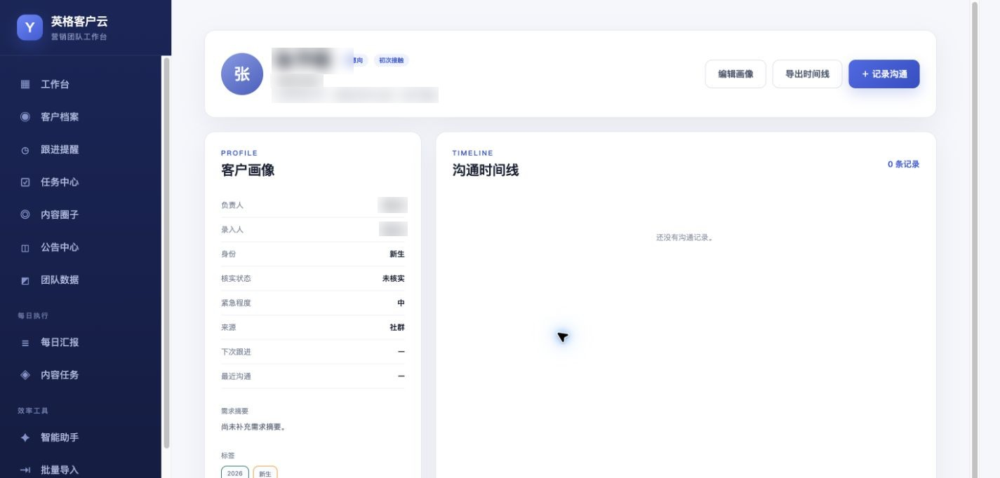

客户详情页分为两部分：

- 左侧“客户画像”：负责人、录入人、身份、核实状态、紧急程度、来源、下次跟进、最近沟通、需求摘要、标签和内部备注。
- 右侧“沟通时间线”：按时间展示沟通渠道、摘要、详细记录、沟通结果和下一次跟进。

页面顶部可执行：

- **编辑画像**：更新客户基础资料、状态、标签和跟进安排。
- **导出时间线**：下载该客户的沟通时间线 Excel。
- **记录沟通**：新增沟通记录，并可同步更新客户状态。

### 5.4 编辑客户画像

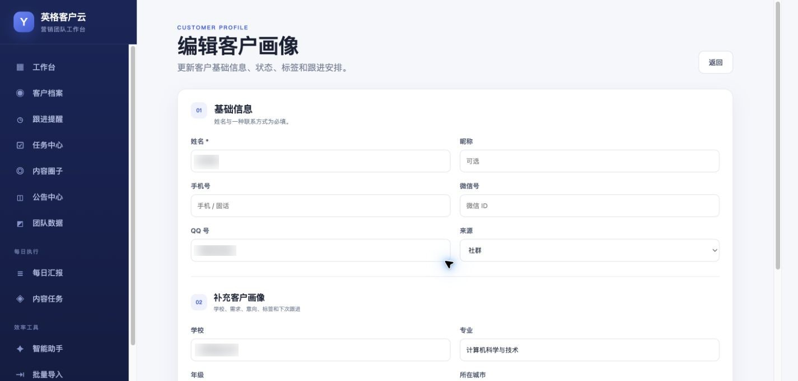

1. 打开客户详情。
2. 点击“编辑画像”。
3. 系统自动回填现有资料。
4. 修改需要更新的字段。
5. 点击“保存修改”。

保存时会再次执行联系方式查重，并使用数据版本号防止两个人同时编辑造成静默覆盖。如果页面提示版本冲突，应返回客户详情、刷新后重新修改。

客户负责人、所属团队和可见范围在普通画像编辑中会保持原值，不会因为修改姓名、状态或标签而意外改变。

### 5.5 记录沟通并形成事务闭环

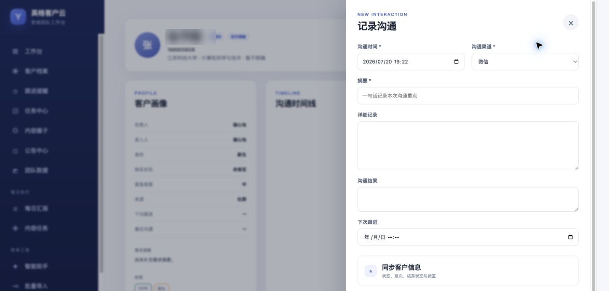

1. 在客户详情点击“记录沟通”。
2. 填写沟通时间、沟通渠道和摘要。
3. 按需填写详细记录、沟通结果和下次跟进时间。
4. 展开“同步客户信息”，可同时调整当前状态、报名意向、核实状态和标签。
5. 点击“完成记录”。

一次成功提交会在同一业务事务中完成：

- 新增沟通时间线记录。
- 更新客户最近沟通时间。
- 按选择更新客户状态、意向、核实状态和标签。
- 根据下次跟进时间创建或更新提醒。

请勿连续重复点击提交按钮。若网络中断，应先刷新客户时间线确认是否已经保存，再决定是否重试。

### 5.6 归档客户

“归档客户”适用于已经结束、无效或暂时不再跟进的档案。归档后：

- 客户默认不出现在活跃列表中。
- 未完成提醒会同时取消。
- 历史画像和沟通记录仍然保留。
- 可在客户列表勾选“包含归档”后查看。

归档属于重要操作，确认前应检查是否仍有待处理业务。

### 5.7 QQ 对话工作台与客户时间线同步

`ORG_ADMIN`、`TEAM_MANAGER` 和 `MEMBER` 可从左侧导航进入“QQ 对话”；`VIEWER` 没有扫码、预览和入档权限。

首次使用：

1. 点击“创建连接并显示二维码”，使用本人工作 QQ 扫码。
2. 扫码后点击“我已扫码，刷新状态”。每名员工只有一个独立 QQ 实例，不能切换到其他员工实例。
3. 连接成功后，页面出现完整 QQ 工作台。长期 QCE Token、Bridge Token 和 Docker 管理能力不会传到浏览器。

查找与预览：

1. 工作台会自动分页加载全部好友、群聊，并合并临时会话、服务号和设备会话。
2. 可按备注、昵称、QQ 号、群名或群号搜索；号码精确匹配优先显示。
3. 点击会话先看最近 50 条消息；可翻页、滚动加载、限定日期、搜索当前会话内容或手动刷新。
4. 图片和表情经当前账号绑定的受控代理显示；语音、视频、文件、合并转发和系统消息按工作台支持方式展示。导出、任务、表情、群文件与群相册均只操作本人的隔离实例。
5. 仅浏览不会调用 AI，也不会在 CRM 创建任何记录。

同步私聊或临时会话：

1. 在消息预览右上角点击“同步到客户云”。
2. 系统按 QQ 号搜索当前有权访问的 CRM 档案：唯一命中自动选中；多条命中时停止自动关联；无命中可点击“使用当前 QQ 快速新建客户”。
3. 快速建档会预填昵称、QQ 和来源“QQ”；填写真实姓名并通过正式查重后，系统返回原同步抽屉。
4. 确认开始和结束时间，再点击“生成 AI 草稿并准备入档”。
5. 逐项核对摘要、客户原话、目标、顾虑、适配、禁忌、结果和下一步；确认后才写入同一份客户档案的时间线。

同步群聊：

1. 点击群聊的“同步到客户云”后，必须从群成员中选择本次要入档的目标客户。
2. 系统使用目标成员 QQ 匹配档案，不能把群号当成客户 QQ。
3. 必须勾选“包含第三方对话，已确认具有业务必要性”。
4. AI 只允许引用目标成员的原话；其他群成员发言只用于理解上下文。任何无法确认的信息应保持“未确认”。

安全与故障提示：

- 浏览器不会保存 QQ 长期 Token，媒体链接 5 分钟失效且不能跨员工或跨实例使用。
- 相同实例、会话、时间范围、消息和客户不能重复预览入档。
- `CUSTOMER_QQ_MISMATCH` 表示目标 QQ 与档案冲突；应先修正档案，不要强行绕过。
- `QQ_GROUP_CONTEXT_CONFIRMATION_REQUIRED` 表示群目标成员或第三方内容确认不完整。
- 达到个人 10 GB 导出配额或服务器磁盘低于安全阈值时，新导出会停止，但已有 CRM 数据不受影响。
- 撤销连接会删除本人的 QQ 实例会话卷，下一次必须重新扫码；已写入 CRM 的时间线和按策略保存的加密原文不会因此被删除。

---

## 6. 跟进提醒

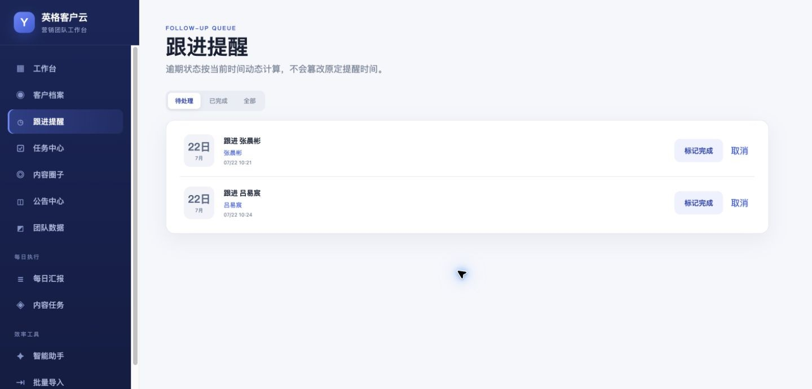

提醒页面提供三个分区：

- **待处理**：尚未完成或取消的提醒。
- **已完成**：已经执行并手工标记完成的提醒。
- **全部**：包含待处理、已完成和已取消提醒。

操作方法：

1. 点击客户名称可返回客户详情。
2. 完成跟进并记录沟通后，点击“标记完成”。
3. 明确不再需要该提醒时，点击“取消”。

红色“已逾期”是根据当前时间动态计算的显示状态，不会修改原始提醒时间。建议先记录沟通，再完成提醒，以保证时间线完整。

---

## 7. 任务中心

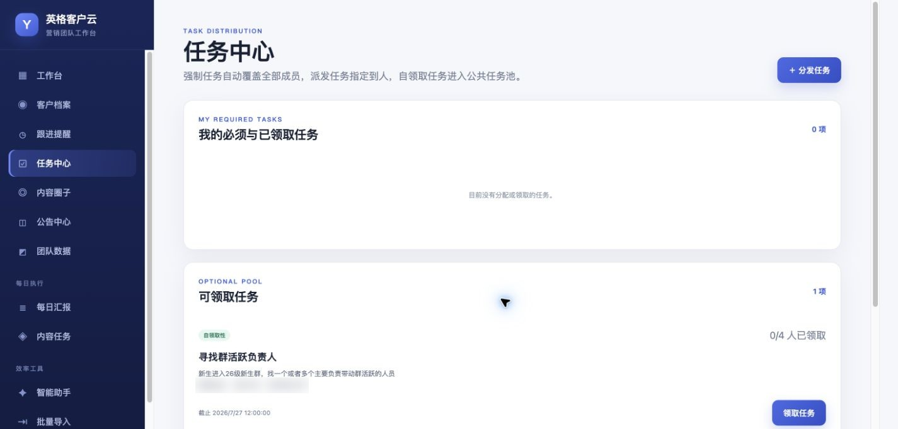

### 7.1 三种任务类型

| 类型 | 分发方式 | 适用场景 |
| --- | --- | --- |
| 强制性 | 发布时自动分配给全部有效成员 | 全员必须完成的制度性工作 |
| 派发性 | 管理员选择具体成员 | 定向渠道对接、专项执行 |
| 自领取性 | 进入公共任务池，成员主动领取 | 数量有限、成员可自选的工作 |

### 7.2 管理员创建并分发任务

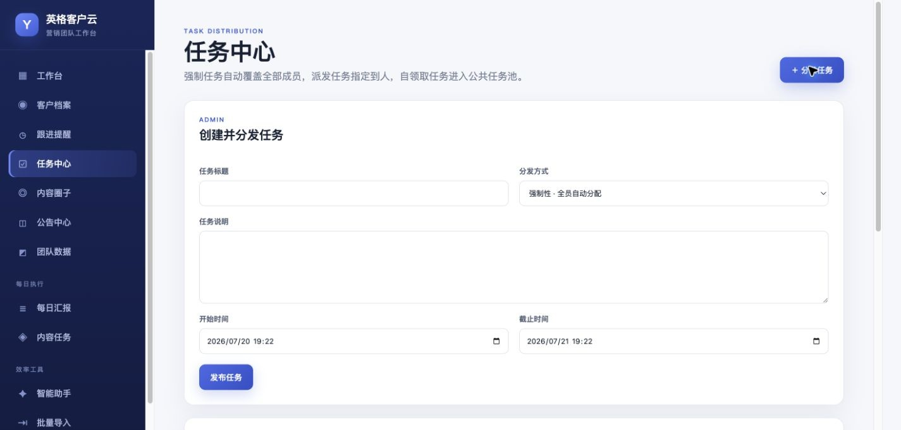

1. 点击右上角“分发任务”。
2. 填写任务标题和说明。
3. 选择强制性、派发性或自领取性。
4. 设置开始时间和截止时间。
5. 派发性任务选择成员；自领取任务设置领取人数上限。
6. 点击“发布任务”。

### 7.3 成员执行任务

成员在“我的必须与已领取任务”中完成以下流程：

1. 自领取任务先在“可领取任务”点击“领取任务”。
2. 开始执行后点击“标记进行中”。
3. 填写成果说明和可选成果链接。
4. 点击“提交验收”。
5. 如果被退回，根据退回说明修改后再次提交。

### 7.4 主管或管理员验收

1. 在“全部任务进度”或“本团队任务验收”找到目标任务。
2. 点击“查看验收”。
3. 检查成果说明和成果链接。
4. 符合要求时点击“验收完成”。
5. 不符合要求时填写原因并点击“退回”。

### 7.5 编号、排序、关闭和删除

- 所有任务显示 `#001`、`#002` 等编号。
- 列表按创建时间倒序展示，最新任务位于最上方。
- “关闭任务”用于停止继续领取或执行，同时保留全部历史。
- “删除”仅限组织管理员。
- 只有尚未领取、执行、提交或验收的任务可以硬删除；已经产生进度的任务必须关闭，以保留成员成果和审计历史。
- 删除确认后不可恢复，尚未开始的分配记录会一并移除。

---

## 8. 自媒体内容任务

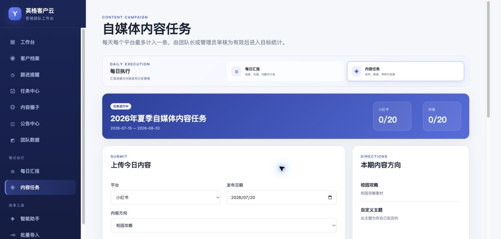

### 8.1 内容任务周期

页面顶部显示本期任务名称、开始日期、结束日期，以及个人小红书和抖音有效完成数。只有位于任务周期内、满足每日规则并经审核为有效的内容才计入目标。

### 8.2 提交内容

1. 选择平台：小红书或抖音。
2. 选择发布日期。发布日期不能晚于今天，也应位于任务周期内。
3. 选择管理员发布且仍启用的内容方向。
4. 填写内容主题和公开链接。
5. 填写播放量、点赞量和收藏量。
6. 勾选原创及质量声明。
7. 点击“提交并公开到圈子”。

系统每天每个平台最多计入一条内容。超出限制、任务周期无效、链接非法或内容方向停用时，页面会显示服务端错误原因。

### 8.3 更新互动指标

在“我的发布记录”中修改播放、点赞、收藏数据，点击“更新数据”。审核结果会显示为待审核、有效或不计入；不计入时同时显示审核原因。

### 8.4 内容方向与审核

- 组织管理员可发布、启用或停用内容方向。
- 团队主管可审核所负责团队提交的内容。
- 组织管理员可审核全组织内容。
- 判定“不计入”时应填写清晰原因，方便成员修正。

---

## 9. 内容圈子

### 9.1 卡片模式

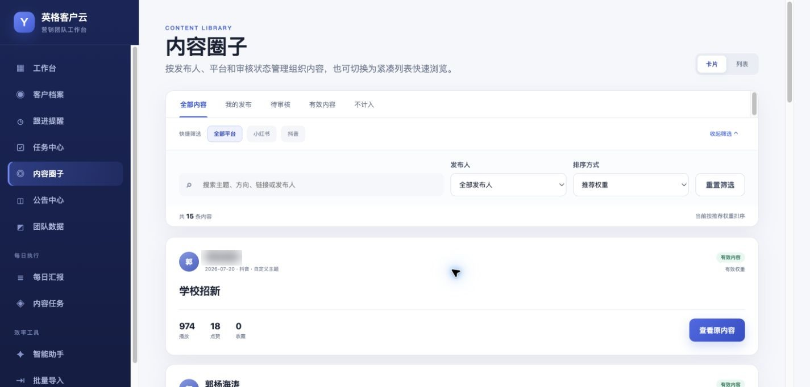

卡片模式适合浏览主题和互动数据，每张卡片显示发布人、发布日期、平台、内容方向、审核状态、推荐权重、播放、点赞和收藏。

### 9.2 列表模式

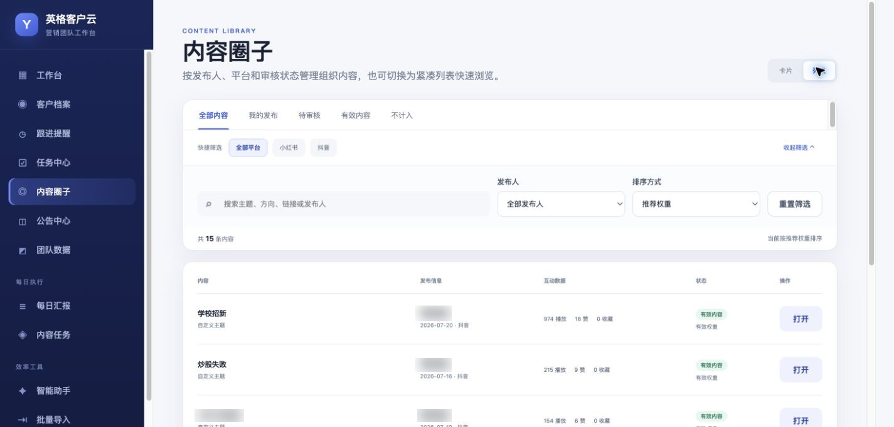

列表模式适合快速对比大量内容。点击页面右上角“卡片”或“列表”可即时切换，不会修改业务数据。

### 9.3 分区和筛选

| 分区/筛选 | 说明 |
| --- | --- |
| 全部内容 | 当前组织范围内可浏览的全部内容 |
| 我的发布 | 仅显示当前成员提交的内容 |
| 待审核 | 等待团队主管或管理员审核 |
| 有效内容 | 已审核计入内容任务 |
| 不计入 | 被判定不计入的内容 |
| 平台 | 全部平台、小红书、抖音 |
| 搜索 | 主题、内容方向、链接或发布人 |
| 发布人 | 按具体成员筛选 |
| 排序 | 推荐权重、最新发布、播放、点赞或收藏 |

“推荐权重”综合审核状态和互动指标排序；无效内容权重较低。点击“打开”或“查看原内容”会在新窗口访问发布链接。

---

## 10. 公告中心

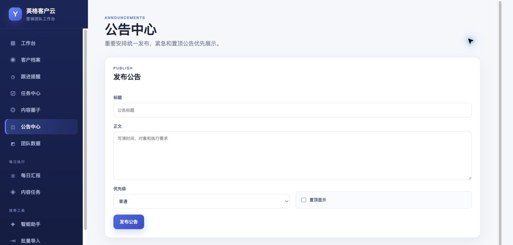

全部登录用户可以查看已发布公告。组织管理员和团队主管可以发布公告。

发布步骤：

1. 填写公告标题和正文。
2. 选择普通、重要或紧急优先级。
3. 如需长期突出显示，勾选“置顶显示”。
4. 点击“发布公告”。

管理规则：

- 置顶和紧急公告优先展示。
- 发布人可以编辑自己的公告；组织管理员可以管理全组织公告。
- 归档不会删除历史公告。
- 管理员或主管勾选“显示已归档公告”后可查看归档内容。
- 正文应写清时间、对象、负责人和执行要求，避免仅写口号。

### 10.1 产品更新提示与历史

新版本发布后，系统会向每个账号显示一次全屏更新说明。点击“我已了解”或“查看完整更新”后，该账号不再重复显示同一版本；不同账号分别确认，互不影响。

如果登录时同时存在 A 类客户三天未跟进提醒，系统先显示业务紧急提醒，关闭后再显示版本更新。左侧“更新日志”长期保留从云端首发以来的版本记录，所有登录角色均可查看。产品更新由发布流程维护，不能由组织管理员修改或删除，也不会与公告中心的组织公告混合。

---

## 11. 团队数据与线索审核

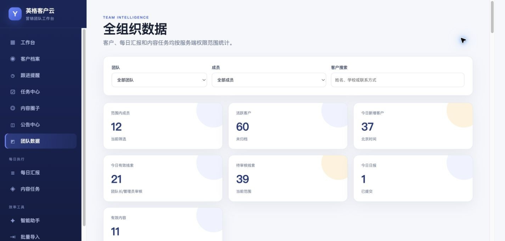

团队数据仅对组织管理员和团队主管开放。管理员查看全组织，主管只查看自己负责的团队。

### 11.1 筛选和指标

页面支持团队、成员、客户关键词和客户年级组合筛选。客户关键词或年级变化后，活跃客户、今日新增、今日有效线索、待审核线索、审核队列和客户明细会同步刷新；右上角显示最近更新时间，也可点击“刷新数据”立即重新读取。成员、日报和内容指标仍按所选团队/成员统计，不会因客户关键词而误减。

客户标签上的数字是服务端返回的完整结果总数，不是当前页已加载条数。客户明细每页 50 条，可用表格下方的“上一页 / 下一页”浏览，因此结果超过 100 条时也不会再出现统计卡与标签数字不一致。

指标包括：

- 范围内成员。
- 活跃客户。
- 今日新增客户。
- 今日有效线索。
- 待审核线索。
- 今日日报。
- 小红书和抖音有效内容。

### 11.2 客户、日报和内容进度标签

- **客户**：显示当前团队和成员筛选范围内的客户。
- **线索审核**：人工确认新增客户是否属于有效线索。
- **每日汇报**：查看成员的有效线索、深度沟通、今日问题和明日计划。
- **内容任务进度**：查看每位成员的小红书、抖音及合计有效数量。

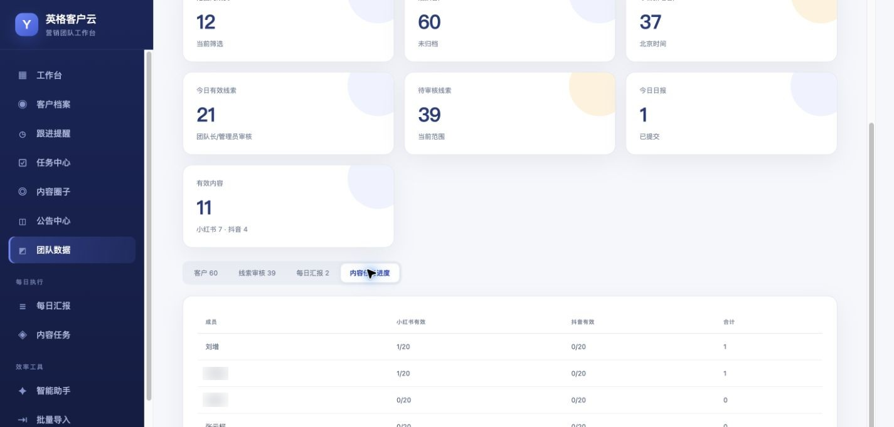

### 11.3 有效线索审核

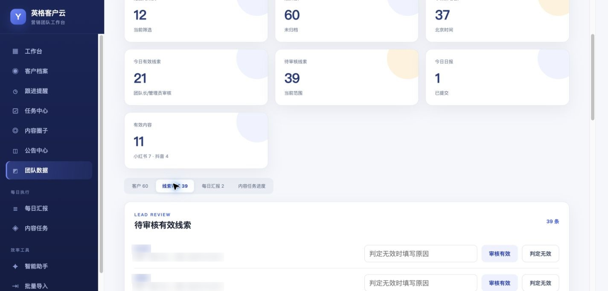

1. 打开“线索审核”标签。
2. 点击客户姓名查看完整画像和来源。
3. 确认真实、符合业务范围时点击“审核有效”。
4. 不符合要求时填写原因并点击“判定无效”。

有效线索审核结果会自动影响当天的有效线索统计和成员日报，不需要成员再次填写数量。

---

## 12. 每日汇报

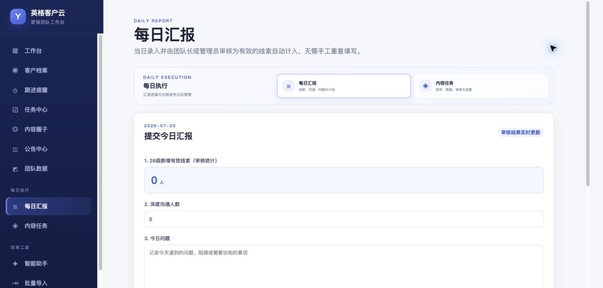

每日汇报包含四项内容：

1. 26 级新增有效线索：由当天录入并经主管或管理员审核有效的客户自动统计。
2. 深度沟通人数：成员手工填写。
3. 今日问题：记录困难、阻碍和需要协助的事项。
4. 明日计划：填写下一工作日最重要的行动。

提交后仍可在当天更新。历史区按日期显示已提交汇报；主管和管理员可在团队数据中按团队和成员查看。

主管和管理员进入“每日汇报”后，还会看到按月展示的汇报日历：

1. 使用“上一月”“下一月”或月份选择器切换统计月份。
2. 每个日期直接显示“已提交人数 / 应汇报人数”；红色表示仍有成员未提交，绿色表示全部提交。
3. 点击某一天，可分别查看“已提交人员”和“未提交人员”实名列表。
4. 未来日期以及不属于当前汇报周期的日期显示“无需统计”，不会被误算为缺交。
5. 组织管理员查看全组织；团队主管只查看自己负责团队及本人，不能查看其他团队。

---

## 13. 批量导入

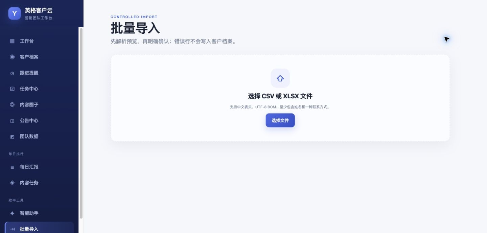

批量导入仅限组织管理员和团队主管，支持 CSV 和 XLSX。

### 13.1 文件要求

至少包含以下表头：

- `姓名`
- `手机号`、`微信号`、`QQ号` 中至少一列有值

支持的可选表头包括：昵称、学校、专业、年级、城市、身份类型、关注方向、需求摘要、报名意向、紧急程度、核实状态、来源渠道、当前状态和内部备注。CSV 建议保存为 UTF-8；系统支持 UTF-8 BOM 和中文表头。

### 13.2 安全导入流程

1. 点击“选择文件”。
2. 点击“生成导入预览”。
3. 检查总行数、可导入行和错误行。
4. 阅读每一错误行的提示并修正源文件。
5. 确认无误后点击“确认导入”。
6. 查看新增、跳过和失败统计。

预览阶段不会写入客户档案。错误行不会写入；重复提交同一导入任务不会重复创建数据。请勿为了让错误行通过而删除必要联系方式或伪造姓名。

---

## 14. 数据导出

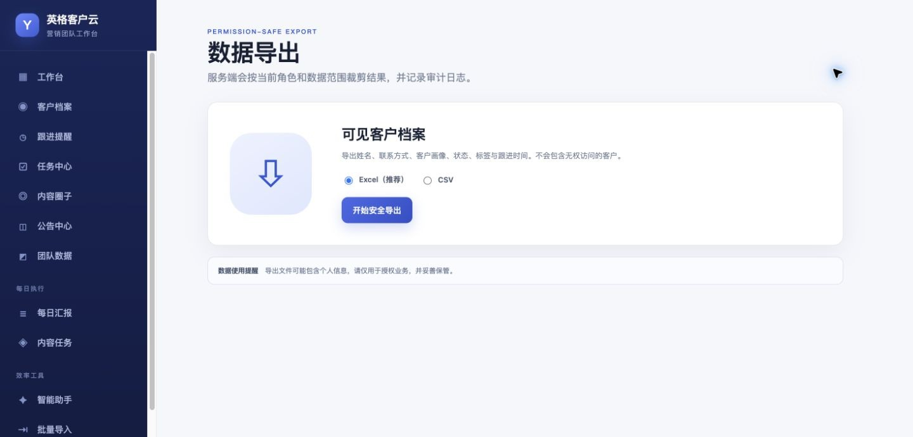

数据导出仅限组织管理员和团队主管。

1. 选择 Excel 或 CSV。Excel 更适合日常查看，CSV 更适合程序处理。
2. 点击“开始安全导出”。
3. 浏览器会下载当前账号可见范围内的客户档案。

导出文件包含客户画像、联系方式、状态、标签、最近联系、下次跟进和内部备注等字段。服务端会再次按角色和数据范围裁剪，不能通过前端参数导出无权访问的数据。

客户详情页的“导出时间线”可单独导出该客户全部沟通记录。所有导出操作都会写入审计日志。下载文件可能包含个人信息，应使用加密磁盘或受控企业文件夹保存，不要上传到公共网盘。

---

## 15. 智能助手

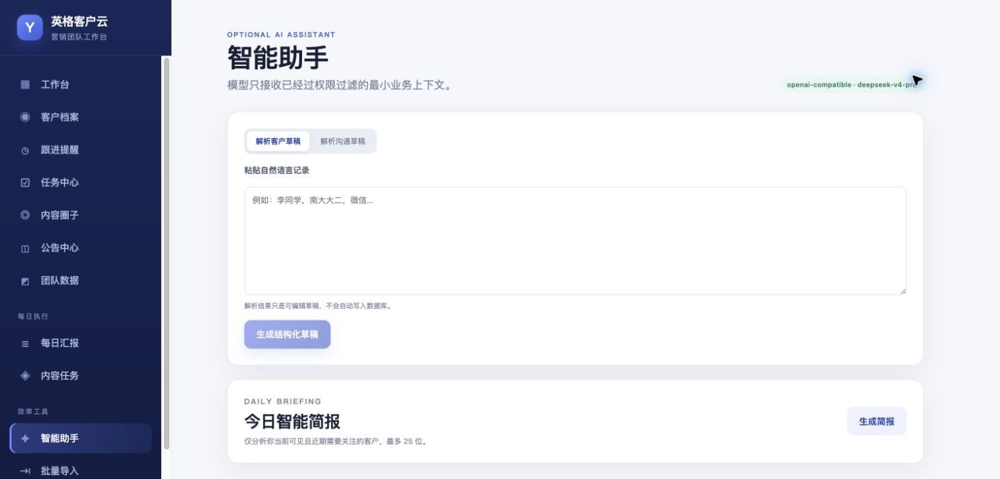

智能助手对组织管理员、团队主管和普通成员开放，只处理当前账号已经有权访问的最小业务上下文。

### 15.1 解析客户草稿

1. 选择“解析客户草稿”。
2. 粘贴聊天记录或自然语言客户信息。
3. 点击“生成结构化草稿”。
4. 检查姓名、联系方式、学校、意向、需求、下次跟进和不确定项。

生成结果只是草稿，不会自动写入数据库。使用者必须核对事实后，再人工建立或编辑客户。

### 15.2 解析沟通草稿

选择“解析沟通草稿”，粘贴本次沟通内容。系统会生成沟通时间、渠道、摘要、结果、待核实项、下一步和客户状态建议。同样不会自动保存。

### 15.3 今日智能简报

点击“生成简报”，系统通过流式输出分析当前账号可见且近期需要关注的客户，最多使用 25 位客户的必要上下文。生成中不要重复点击；若网络断开且没有任何结果，页面会提示简报生成中断。

### 15.4 其他 AI 能力

后端同时提供客户时间线摘要、下一步建议和数据质量检测能力。这些能力通过受权限保护的 API 提供，当前版本没有独立页面按钮，可由后续工作流或经授权的内部集成调用。

AI 使用原则：

- 不要粘贴无关人员信息、密码、密钥或其他敏感凭据。
- AI 输出必须由业务人员核对，不能作为唯一决策依据。
- AI 服务不可用时，客户、提醒、任务、日报、导入导出等基础功能不受影响。

---

## 16. 组织管理

本节全部功能仅限 `ORG_ADMIN`。

### 16.1 成员账户与注册码

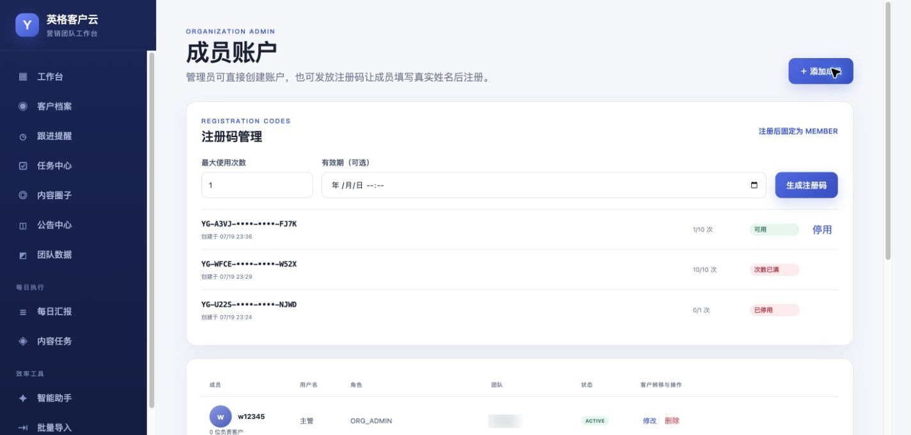

管理员可以：

- 直接创建成员账号并设置姓名、初始密码、角色和团队。
- 生成有最大使用次数和可选有效期的注册码。
- 停用尚未使用完的注册码。
- 修改成员真实姓名、角色、状态和团队。
- 停用或删除成员，同时保留历史记录。

注册码完整值只在生成成功时显示一次，数据库不会保存明文。管理员应立即保存到受控渠道；日后列表只显示掩码提示。

删除成员前的客户转移：

1. 检查该成员负责客户数量。
2. 若数量大于 0，在操作列选择一个有效的客户接收账号。
3. 点击“删除”并确认。
4. 系统转移客户及相关未完成提醒，停用原账号，保留沟通、任务、内容和审计历史。

系统不允许停用或降级最后一个有效组织管理员，也不允许管理员把自己直接改为非管理员或停用状态。

### 16.2 团队与唯一团队长

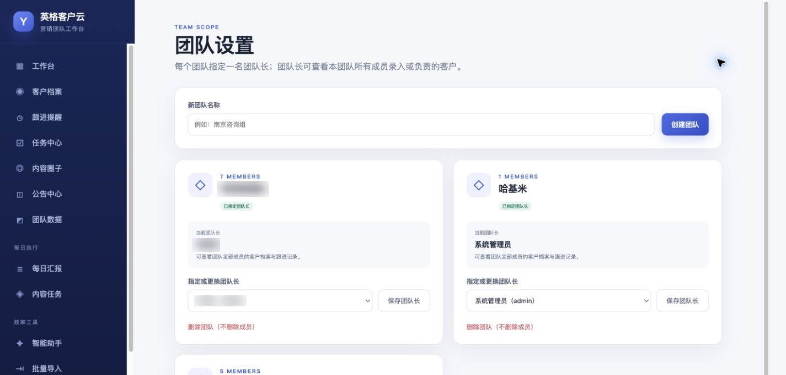

管理员可以创建团队、指定或更换团队长、删除团队。

- 一个团队只能有一名团队长。
- `TEAM_MANAGER` 必须归属一个团队。
- 同一成员不能通过重复设置破坏唯一团队长约束。
- 删除团队不会删除成员、客户或历史记录；原团队成员变为未分组。
- 删除前应先确认是否需要把成员分配到新团队。

### 16.3 字典与标签

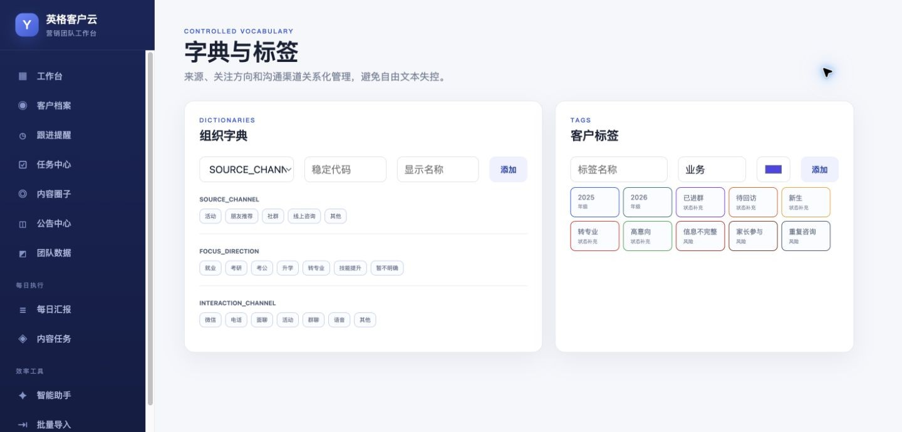

组织字典用于维护稳定、统一的业务词汇：

- `SOURCE_CHANNEL`：客户来源渠道。
- `FOCUS_DIRECTION`：客户关注方向。
- `INTERACTION_CHANNEL`：沟通渠道。
- `SCHOOL`：客户学校选项；系统默认包含“示例大学”和“示例科技大学”。

新增字典时填写稳定代码和显示名称。稳定代码应使用简短、唯一、可长期保留的英文或数字组合，不要随意复用旧代码。

普通员工可以在客户新建或编辑页面补充缺少的学校，但不能维护来源、关注方向和沟通渠道。组织管理员可在本页统一添加学校及其他字典项。

客户标签包含名称、分类和颜色，用于画像和筛选。标签应表达可执行业务含义，例如“待回访”“资料不完整”，避免建立含义重复的同义标签。

### 16.4 审计日志

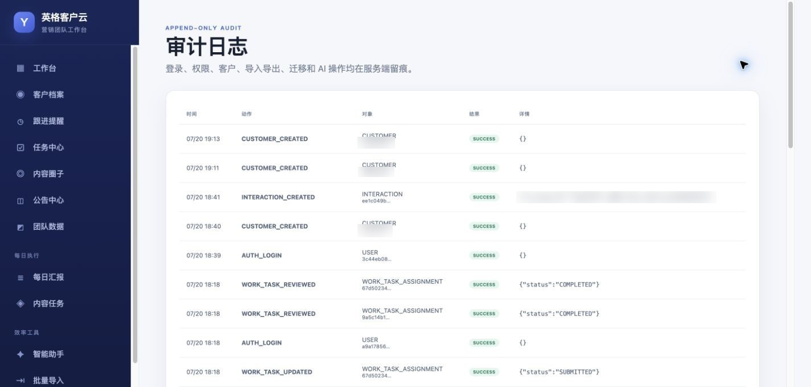

审计日志按时间记录动作、对象、结果和必要详情，包括登录、权限、客户、导入导出、任务、内容审核、公告、迁移和 AI 管理操作。

排查问题时建议记录：

- 操作发生的北京时间。
- 操作账号和页面。
- 页面显示的错误内容。
- 接口返回的 `traceId`。
- 审计日志中的动作、结果和对象 ID。

审计日志是追加式记录，不应通过数据库工具手工修改。

---

## 17. 智能助手管理员配置

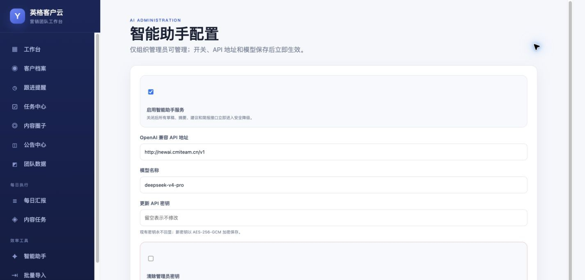

仅组织管理员可以进入“智能助手配置”。配置保存后动态生效，不需要重启服务。

### 17.1 服务开关

- 勾选“启用智能助手服务”：允许草稿、摘要、建议、质量检测和简报接口调用模型。
- 取消勾选：全部 AI 接口立即进入安全降级；其他业务功能继续运行。

### 17.2 API 地址与模型

- **OpenAI 兼容 API 地址**：填写提供商的 `/v1` 兼容地址。
- **模型名称**：填写该提供商实际支持的模型标识。
- 地址和模型保存后立即用于新请求。

切换提供商前，应先确认其兼容 OpenAI Chat Completions 调用方式，并使用少量非敏感数据做真实冒烟验证。

### 17.3 API 密钥

- 密钥输入框留空表示保持现有密钥不变。
- 新密钥不会在保存后回显。
- 管理员密钥使用 AES-256-GCM 加密保存。
- 勾选“清除管理员密钥”后，如果服务器环境仍配置密钥，系统会回退到环境配置。
- 页面只显示密钥是否已配置和来源，不显示明文或密文。
- 审计日志只记录密钥是否变更，不记录密钥内容。

### 17.4 推荐配置顺序

1. 关闭服务开关。
2. 填写并核对 API 地址和模型名称。
3. 输入或更新 API 密钥。
4. 保存配置。
5. 重新打开服务开关并保存。
6. 在智能助手页用一段不含敏感信息的短文本验证草稿解析。

如果出现限流、超时或提供商异常，先关闭服务开关保障业务页面稳定，再检查提供商状态、模型名称、配额和网络。

---

## 18. 账户设置与退出

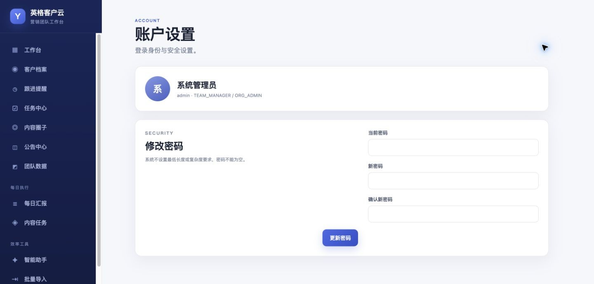

账户设置页显示真实姓名、用户名和角色，并提供密码修改功能。

修改密码：

1. 输入当前密码。
2. 输入新密码和确认新密码。
3. 点击“更新密码”。
4. 看到“密码已更新”后，妥善保存新密码。

系统当前不强制长度和复杂度，但建议使用密码管理器生成独立强密码。不要在聊天、截图、工单或共享文档中发送密码。

退出系统时点击左侧导航底部“退出”。退出会结束当前浏览器会话；在公共电脑上使用后还应关闭浏览器窗口。

---

## 19. 推荐业务流程

### 19.1 成员每日流程

1. 登录后查看工作台的逾期和今日提醒。
2. 打开客户详情并完成沟通。
3. 记录沟通结果、同步状态并安排下次跟进。
4. 完成或取消对应提醒。
5. 查看任务中心，执行强制、派发或已领取任务。
6. 提交当天小红书或抖音内容，更新互动指标。
7. 填写并提交每日汇报。

### 19.2 团队主管每日流程

1. 在团队数据筛选自己的团队。
2. 审核新增有效线索。
3. 检查逾期、高意向和沉默客户。
4. 验收团队成员任务提交。
5. 审核自媒体内容并填写不计入原因。
6. 检查成员日报和内容任务进度。
7. 必要时发布团队公告。

### 19.3 组织管理员日常流程

1. 检查全组织核心指标和审计日志。
2. 管理成员状态、团队归属和唯一团队长。
3. 生成或停用注册码。
4. 维护来源、关注方向、沟通渠道和客户标签。
5. 创建工作任务并跟踪验收。
6. 管理公告、内容方向和 AI 服务配置。
7. 定期执行权限裁剪导出并妥善保存业务备份。

---

## 20. 安全、审计与接口说明

### 20.1 浏览器安全机制

- 登录使用服务端 Session，不在前端保存长期访问令牌。
- 登录成功后会迁移 Session 标识，降低会话固定风险。
- 写操作使用 CSRF Cookie 与请求头双重校验，网页端自动处理。
- 跨组织、跨团队、私有资源和随机 UUID 请求均由服务端权限校验。
- 统一错误响应包含错误代码、说明、字段错误、`traceId` 和时间。

### 20.2 管理员 OpenAPI

正式环境的 OpenAPI/Swagger 仅组织管理员可访问：

- `/swagger-ui/index.html`
- `/v3/api-docs`

接口调试仍受登录 Session、CSRF 和业务权限限制。不要把生产 Cookie、CSRF 值或 API 密钥复制到截图、聊天或代码仓库。

### 20.3 AI 接口能力

| 能力 | 接口 | 说明 |
| --- | --- | --- |
| 可用性 | `GET /api/v1/assistant/availability` | 返回是否可用、提供商和模型，不返回密钥 |
| 客户草稿 | `POST /api/v1/assistant/customer-draft` | 自然语言转结构化客户草稿 |
| 沟通草稿 | `POST /api/v1/assistant/interaction-draft` | 自然语言转沟通草稿 |
| 客户摘要 | `GET /api/v1/assistant/customers/{id}/summary` | SSE 流式输出客户时间线摘要 |
| 下一步建议 | `GET /api/v1/assistant/customers/{id}/next-actions` | SSE 流式输出后续行动建议 |
| 数据质量 | `GET /api/v1/assistant/customers/{id}/data-quality` | SSE 流式输出资料完整性检查 |
| 每日简报 | `GET /api/v1/assistant/daily-briefing` | SSE 流式输出今日简报 |
| 管理配置 | `GET/PUT /api/v1/admin/assistant-settings` | 仅组织管理员，动态管理开关、地址、模型和密钥 |

### 20.4 健康检查与问题上报

系统健康检查由运维使用。普通用户遇到问题时，不要尝试直接修改数据库，应提供：

- 发生时间。
- 使用账号与角色。
- 页面地址和操作步骤。
- 错误提示或截图。
- `traceId`（如页面或接口响应提供）。

---

## 21. 常见问题

### 21.1 为什么看不到某个客户？

通常是负责人、团队、私有可见范围或组织隔离导致。请让团队主管确认客户归属；不要通过猜测 UUID 或修改请求参数尝试访问。

### 21.2 为什么无法编辑客户画像？

确认当前账号不是 `VIEWER`、客户未归档且账号对该客户具有编辑权限。若看到“编辑画像”但保存失败，请记录错误和 `traceId` 联系管理员。

### 21.3 为什么相似姓名仍可以建档？

姓名相似可能是同名不同人。系统要求填写继续创建原因；联系方式完全相同则会阻止创建。

### 21.4 为什么任务不能删除？

任务已经有成员领取、执行、提交或验收记录。为了保留成果和审计历史，应使用“关闭任务”，只有完全未开始的任务可以删除。

### 21.5 为什么内容没有计入目标？

检查任务周期、发布日期、每日平台上限、原创声明、内容方向和审核状态。不计入内容会显示审核原因。

### 21.6 为什么日报中的有效线索数量不能手工修改？

该数字来自当天建档并经团队主管或管理员审核有效的客户，属于自动统计口径。

### 21.7 为什么导入按钮是灰色？

尚未选择文件、预览没有可导入行，或当前账号不是管理员/团队主管。先查看错误行提示并修正文件。

### 21.8 为什么智能助手按钮不可用？

可能是管理员关闭服务、未配置密钥、提供商不可用，或当前角色为 `VIEWER`。基础业务功能仍可继续使用。

### 21.9 API 密钥保存后在哪里查看？

系统不会回显密钥。页面只显示是否已配置及来源。需要更换时输入新密钥保存；不要尝试从数据库或日志读取原密钥。

### 21.10 页面显示旧样式怎么办？

先执行强制刷新：Windows 使用 `Ctrl + F5`，macOS 使用 `Command + Shift + R`。仍未更新时关闭旧标签页后重新打开系统。

---

## 附录：截图资产

本手册图片统一保存在 [`docs/assets/user-manual/`](assets/user-manual/) 目录。新增截图时应使用不含密码、注册码明文、API 密钥或无关个人信息的界面，并同步更新本手册中的相对路径。
